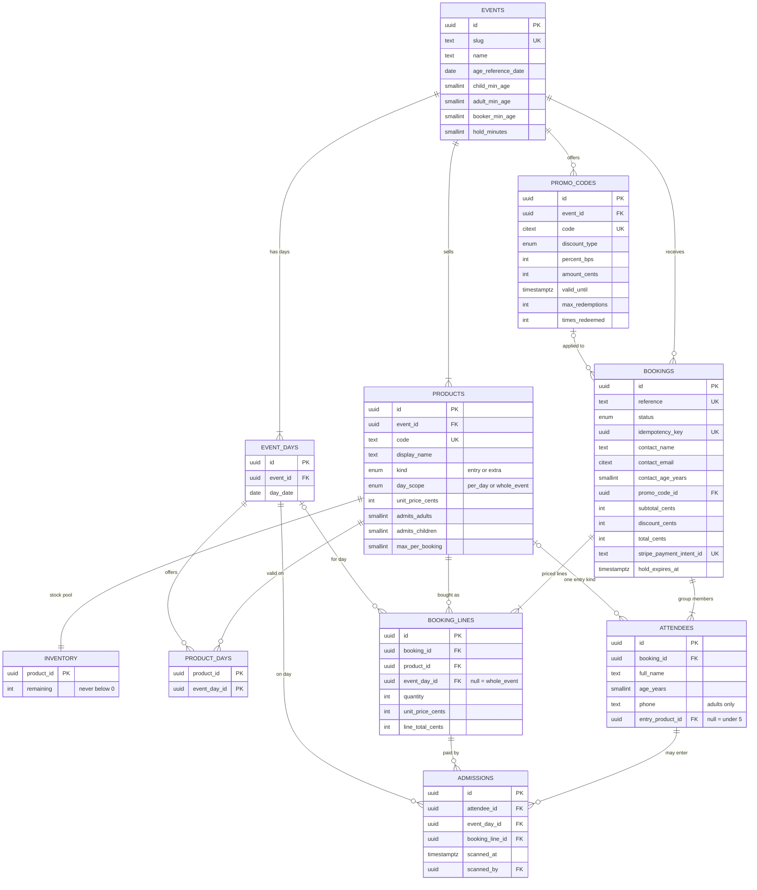

# Design

## Assumptions

Let me first walk you through the assumptions I made before planning the platform architecture.

The brief has the festival on 10–14 Nov 2026, but those dates have already passed, so the seed moves the whole festival to December (10–14 Dec 2026). Below are the assumptions I made across different areas.

### Age and people

1. Age is a whole number, taken as of the first day of the festival (10 Dec). So if a child turns 12 on 12 Dec, they are still a child for the whole festival and the price doesn't change in between.
2. Under-5s are added to the booking but don't get a ticket. They are free, but they still need to be counted for the headcount at the door.
3. The person making the booking has to be 18 or older, but they don't have to attend. For example, a grandparent can book for the whole family, so the contact details are stored on the booking and not on a ticket.
4. For children I only take name and age. A nine year old won't have a phone number or email anyway.
5. Toddlers are excluded from the extra services (workshops and dinner).
6. Extras for a day can only be bought for someone who has an entry ticket for that day.

### Promo codes

1. KIDSFREE makes child-only passes free. It does not apply to the Family Pass or to extras.
2. A promo use is counted when the booking is created, same as stock, and it is released if the booking expires.

### Money and payment

1. All money is stored in whole cents. Percentage discounts are rounded to the nearest cent.
2. Every booking stores the price at the time it was made. If the price is changed later, old bookings stay as they are.
3. Payment is through Stripe in test mode, USD only. I had already planned to go with Stripe from the start.

## 1. Schema design

- I've split it into three layers. The **catalogue** (what is on sale) hardly changes. The **counters** (stock and promo usage) change all the time and need to be protected. **Bookings** are what a family actually bought, and they don't change after payment. Keeping these separate keeps each part simple.
- Rules are based on the data and not on product names. Every product says how many adults and how many children it admits. The age check, the Family Pass check and KIDSFREE all use these numbers, so if a ticket gets renamed, nothing breaks.
- There is one pricing formula for everything: price × quantity. There is no special logic for each ticket type.
- What was paid and who can enter are kept separate. `booking_lines` is the bill, and `admissions` is the list for the door, with one row per person per day.
- Postgres also enforces the important rules, so even if my server code has a bug, the database will still reject:
    - stock going below zero
    - a total that doesn't add up
    - a Garba Workshop on 12 Dec
    - a child admitted on an adult pass
    - the same person admitted twice on the same day
- I'm using a proper database (Postgres on Neon). Vercel serverless functions don't keep anything between requests, so stock can't be kept in memory or in files.

Below are the tables and a diagram showing how each table relates to the others.



## 2. Endpoints

| # | Method & path | Use case | Called by |
| --- | --- | --- | --- |
| 1 | `GET /api/events/{slug}/catalog` | Festival info, days, products, prices, stock left, age limits | Page load |
| 2 | `POST /api/events/{slug}/quote` | Prices a cart and checks the rules, **without** holding stock | On every change, and when a promo code is applied |
| 3 | `POST /api/bookings` | Checks again, prices, holds stock and the promo use, and creates the Stripe payment | The "Pay" button |
| 4 | `GET /api/bookings/{id}` | Booking status and summary | Payment step and confirmation page |
| 5 | `POST /api/webhooks/stripe` | Stripe tells us the payment succeeded and the booking becomes `confirmed` | Stripe only |
| 6 | `GET /api/cron/release-expired-holds` | Releases stock from unpaid bookings older than 15 minutes | Vercel's scheduled jobs, protected by a secret |

### 1. Catalog: `GET /api/events/sharad-utsav-2026/catalog`

```json
{
  "event": {
    "slug": "sharad-utsav-2026",
    "name": "Sharad Utsav 2026",
    "currency": "USD",
    "days": ["2026-12-10", "2026-12-11", "2026-12-12", "2026-12-13", "2026-12-14"],
    "ageRules": { "referenceDate": "2026-12-10", "childMinAge": 5, "adultMinAge": 12, "bookerMinAge": 18 },
    "holdMinutes": 15
  },
  "products": [
    {
      "code": "DAY_PASS_ADULT", "name": "Day Pass – Adult", "kind": "entry", "dayScope": "per_day",
      "unitPriceCents": 1500, "admits": { "adults": 1, "children": 0 },
      "availableDays": ["2026-12-10", "…"], "remaining": 380, "soldOut": false
    },
    {
      "code": "GARBA_WORKSHOP", "name": "Garba Workshop", "kind": "extra", "dayScope": "per_day",
      "unitPriceCents": 2000, "availableDays": ["2026-12-11", "2026-12-13"],
      "remaining": 2, "soldOut": false
    }
  ]
}
```

The frontend uses this for display only. All prices are calculated again on the server.

### 2 & 3. Quote and booking (both take the same cart)

Each attendee carries their own entry ticket, which fits the one-ticket-type-per-person rule. The browser gives each attendee a temporary ID like `"a1"` so the server can match people to their tickets.

```json
{
  "contact": { "name": "Ayush Rawat", "email": "a@x.com", "phone": "+1 469…", "ageYears": 34 },
  "attendees": [
    { "clientId": "a1", "fullName": "Ayush Rawat", "ageYears": 34,
      "entry": { "productCode": "FAMILY_PASS", "days": ["2026-12-12"] } },
    { "clientId": "a2", "fullName": "Priya Rawat", "ageYears": 32,
      "entry": { "productCode": "FAMILY_PASS", "days": ["2026-12-12"] } },
    { "clientId": "a3", "fullName": "Riya", "ageYears": 9,
      "entry": { "productCode": "FAMILY_PASS", "days": ["2026-12-12"] } },
    { "clientId": "a4", "fullName": "Kabir", "ageYears": 7,
      "entry": { "productCode": "FAMILY_PASS", "days": ["2026-12-12"] } },
    { "clientId": "a5", "fullName": "Dadi", "ageYears": 68,
      "entry": { "productCode": "DAY_PASS_ADULT", "days": ["2026-12-12", "2026-12-13"] } },
    { "clientId": "a6", "fullName": "Baby Anvi", "ageYears": 2, "entry": null }
  ],
  "extras": [
    { "productCode": "DINNER_PLATE", "day": "2026-12-12", "quantity": 5 },
    { "productCode": "GARBA_WORKSHOP", "day": "2026-12-13", "quantity": 1 },
    { "productCode": "DANDIYA_STICKS", "quantity": 2 }
  ],
  "promoCode": "SEVA10"
}
```

- **Quote** only needs what affects the price: ages, tickets, extras and the promo code. Names and contact details are optional here, so the total can update live while the form is still half filled.
- **Booking** needs everything, and also:
    - an `Idempotency-Key` header, which is a random ID the browser generates once per checkout
    - `"expectedTotalCents": 14400`, which is the total the family saw on screen. If the server calculates a different total (for example, the promo code ran out in between), it rejects the booking instead of charging an amount they didn't expect.

**How the server turns the cart into priced lines:** it groups attendees by ticket and day.

- The 4 people on `FAMILY_PASS` for 12 Dec become one Family Pass line. With 8 people (4 adults and 4 children), it would be quantity 2.
- Dadi becomes 2 `DAY_PASS_ADULT` lines, one for 12 Dec and one for 13 Dec, quantity 1 each.
- `entry: null` is only allowed for under-5s.

#### Quote response (always 200, even if there are problems)

```json
{
  "lines": [
    { "productCode": "FAMILY_PASS",    "label": "Family Pass",           "day": "2026-12-12", "quantity": 1, "unitPriceCents": 4000, "lineTotalCents": 4000 },
    { "productCode": "DAY_PASS_ADULT", "label": "Day Pass – Adult",      "day": "2026-12-12", "quantity": 1, "unitPriceCents": 1500, "lineTotalCents": 1500 },
    { "productCode": "DAY_PASS_ADULT", "label": "Day Pass – Adult",      "day": "2026-12-13", "quantity": 1, "unitPriceCents": 1500, "lineTotalCents": 1500 },
    { "productCode": "DINNER_PLATE",   "label": "Dinner Plate",          "day": "2026-12-12", "quantity": 5, "unitPriceCents": 1200, "lineTotalCents": 6000 },
    { "productCode": "GARBA_WORKSHOP", "label": "Garba Workshop",        "day": "2026-12-13", "quantity": 1, "unitPriceCents": 2000, "lineTotalCents": 2000 },
    { "productCode": "DANDIYA_STICKS", "label": "Dandiya Sticks (pair)", "day": null,         "quantity": 2, "unitPriceCents": 500,  "lineTotalCents": 1000 }
  ],
  "subtotalCents": 16000,
  "promo": { "code": "SEVA10", "status": "applied", "discountCents": 1600, "message": "10% off your booking." },
  "totalCents": 14400,
  "currency": "USD",
  "issues": [],
  "canBook": true
}
```

That is $40 + $15 + $15 + $60 + $20 + $10 = $160.00, minus 10% ($16.00) = **$144.00**. Baby Anvi gets no line, and isn't counted for dinner.

Problems come back as a list inside the response and not as an error, so the form can show each message next to the field it belongs to. For example, if Kabir (7) had been put on `DAY_PASS_ADULT` instead:

```json
"issues": [
  { "path": "attendees[3].entry.productCode", "code": "AGE_TICKET_MISMATCH",
    "message": "Kabir is 7, so needs a child ticket (ages 5–11)." }
],
"canBook": false
```

#### Booking response (201)

```json
{
  "bookingId": "6f1c…",
  "reference": "SU26-7K3QX",
  "status": "pending_payment",
  "totalCents": 14400,
  "currency": "USD",
  "holdExpiresAt": "2026-12-01T07:30:00Z",
  "payment": { "provider": "stripe", "clientSecret": "pi_…_secret_…" }
}
```

If the same `Idempotency-Key` is sent again (for example, Pay was clicked twice), the API returns the same booking. If the same key comes with a different cart, it returns 409.

### 4. `GET /api/bookings/{id}`

Returns the status (`pending_payment | confirmed | expired | cancelled`), the reference, the priced lines, the totals and the door list:

```json
"admissions": [ { "attendee": "Riya", "day": "2026-12-12", "ticket": "Family Pass" } ]
```

Once the Stripe payment form is done, the page polls this every few seconds until the status becomes `confirmed`.

### 5. Stripe webhook

1. Verify the Stripe signature and reject the request if it doesn't match.
2. If this event ID is already in `processed_stripe_events`, skip it.
3. On `payment_intent.succeeded`, mark the booking as `confirmed` and set `confirmed_at`. If the hold had already expired by then, try to take the stock again, and refund if it's no longer available.
4. On `payment_intent.payment_failed`, leave the booking as `pending_payment` so the family can try again until the hold expires.

### Errors

All errors use the same shape:

```json
{
  "error": {
    "code": "SOLD_OUT",
    "message": "Only 1 Garba Workshop place is left.",
    "details": [ { "path": "extras[1].quantity", "code": "INSUFFICIENT_STOCK", "remaining": 1 } ]
  }
}
```

| HTTP | When | Codes |
| --- | --- | --- |
| 400 | Request is badly formed: invalid JSON, missing fields, wrong data type | `INVALID_REQUEST` |
| 422 | A business rule is broken | `AGE_TICKET_MISMATCH`, `INVALID_AGE`, `BOOKER_UNDER_18`, `FAMILY_PASS_COMPOSITION`, `DAY_NOT_AVAILABLE`, `ENTRY_REQUIRED`, `QUANTITY_LIMIT` |
| 409 | Something changed in between | `SOLD_OUT`, `INSUFFICIENT_STOCK`, `PRICE_CHANGED`, `PROMO_NO_LONGER_VALID`, `IDEMPOTENCY_CONFLICT` |
| 404 | Event or booking not found | `NOT_FOUND` |

Promo statuses (inside a quote, or as an error when booking):

| Status | Message |
| --- | --- |
| `applied` | "10% off your booking." |
| `expired` | "This code expired on 30 Nov." |
| `exhausted` | "This code has reached its usage limit." |
| `not_found` | "We don't recognise that code. Please check the spelling." |
| `not_applicable` | "KIDSFREE applies to child tickets, and there are none in this booking." |

## 3. Tricky cases

1. **A group that doesn't fit the Family Pass.** For 2 adults and 1 child, the Family Pass ($40) costs more than Day Passes ($38). For 3 adults and 2 children, the cheapest option is one Family Pass plus one adult Day Pass.
2. **A joint family on 2 Family Passes.** 4 adults and 4 children can get 2 Family Passes for $80, or Day Passes for $92.
3. **KIDSFREE with a Family Pass.** I wasn't sure whether the code should make the children's part of a Family Pass free, so I made it apply only to passes that admit children only.
4. **FLAT20 on a small booking.** On a $15 booking, $20 off would make the total negative, so the total stops at $0.

## 4. Out of scope

1. **Cancellations, refunds or changes after payment.** The status list already has `cancelled`, so this can be added later.
2. **User accounts or login.** Sign up just adds friction without really protecting anything. The confirmation link uses an ID that is hard to guess.
3. **Admin panel.** Prices, stock and promo codes are set using a seed script. The data model can support an admin screen later.
4. **Door check-in app.** The `admissions` table and its `scanned_at` column are ready, and can be used to build the scanner app for the door later.
5. **Real emails, unless I have time left.** The confirmation is shown on screen along with the booking reference.

## 5. Things I did not do

### No government ID

I decided not to ask for any form of ID.

An ID would help in one place. Two different people can share a name, and an ID would let us stop one person from buying several Family Passes for the same day. But the cost outweighs that benefit:

- **IDs vary.** To be fair to everyone, we would need an "ID type" field and support for several kinds of ID. Accepting only US IDs would shut out foreign nationals who want to attend the festival just as much.
- **Verification is extra work.** An ID number we can't check proves nothing, and checking it means a separate verification step and service.
- **It's sensitive data.** Storing ID numbers turns a ticket site into a store of personal documents, with the security and legal duties that come with that.

The problems an ID seems to solve are handled in other ways:

- **Overselling and double payment** are prevented by guarded stock updates, idempotency keys and Stripe webhook de-duplication. Identity doesn't help there.
- **Abuse** such as bulk holds and promo-code guessing is held back by per-visitor rate limits.
- **At the door**, a volunteer can look at any photo ID matching the booker's name without us ever storing it.
